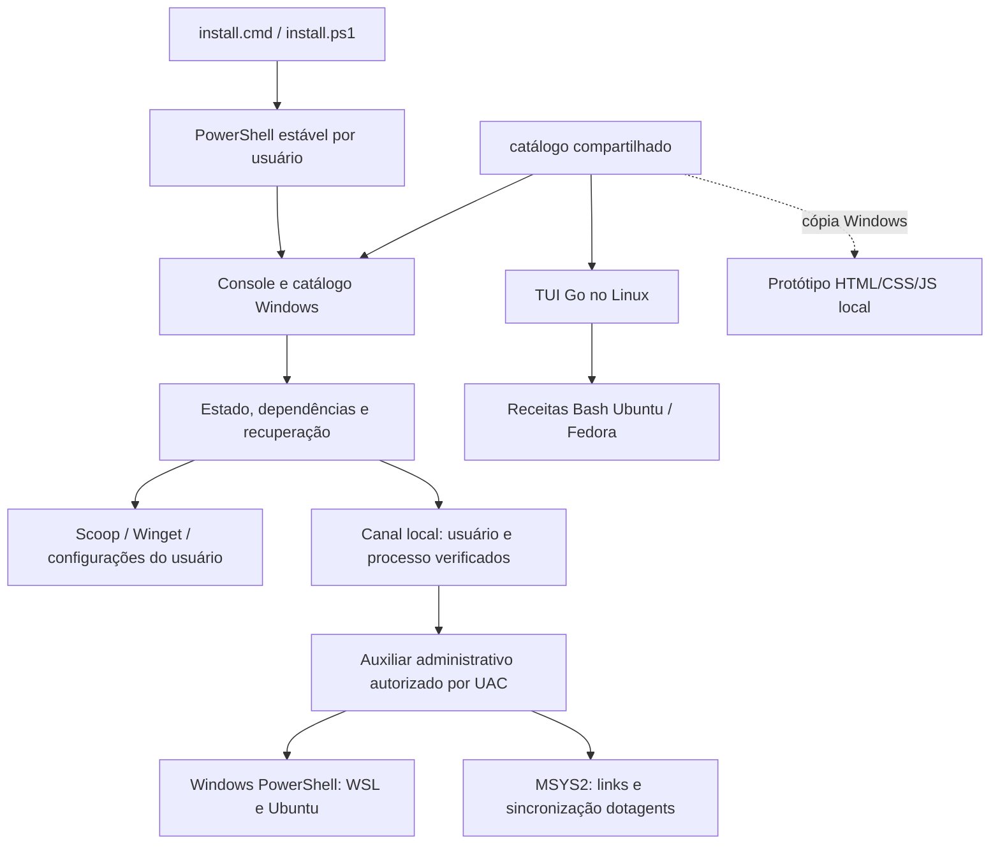

# Arquitetura

O console e as operações por usuário não são elevados. O auxiliar solicita UAC no início, aceita conexões do usuário e PID originais e termina quando o cliente fecha o canal. O runtime vem das releases estáveis oficiais do PowerShell, com validação SHA256 e detecção de BOM no manifesto.

Estado e logs ficam em `%LOCALAPPDATA%\Guepardo`. A configuração concluída do Jellyfin é reutilizada; `-ReconfigureJellyfin` permite reaplicá-la. O WSL consulta a versão do Ubuntu e só converte WSL 1 para 2. O protótipo é independente: não executa instalações nem substitui a TUI Go.
